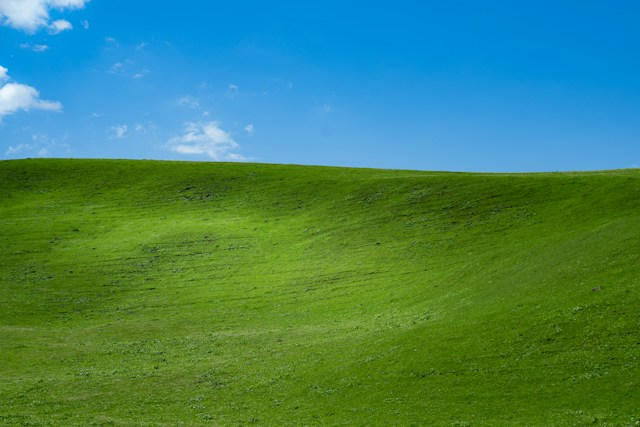

---
# Feel free to add content and custom Front Matter to this file.
# To modify the layout, see https://jekyllrb.com/docs/themes/#overriding-theme-defaults

layout: home
title: Homepage
---

~
`>./home.sh`

### Hallo! :]

Welcome to my website, my name is Blu. This is a personal portfolio and blog where I make stuff that I'm interested in.

 
<i>"Doesn't this look familiar to you...?"</i> [img. credit = Zongnan Bao on Unsplash]

# Contacts

- Github: {{ site.github_username }}
- Twitter: {{ site.twitter_username }}
- Discord: {{ site.discord_username }}

 
~
`>_`
